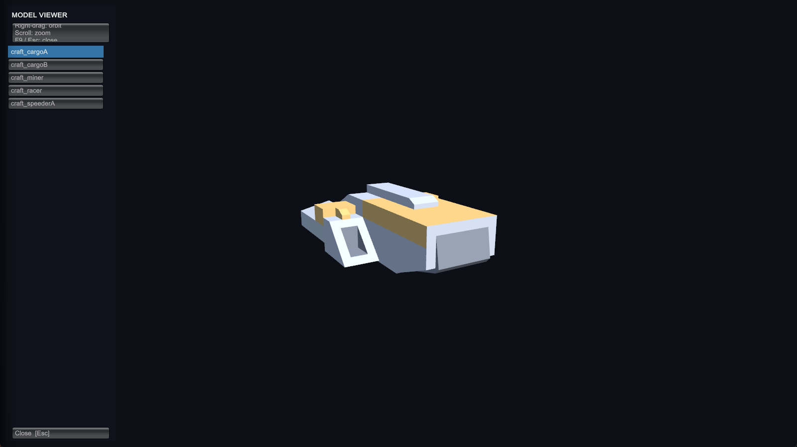
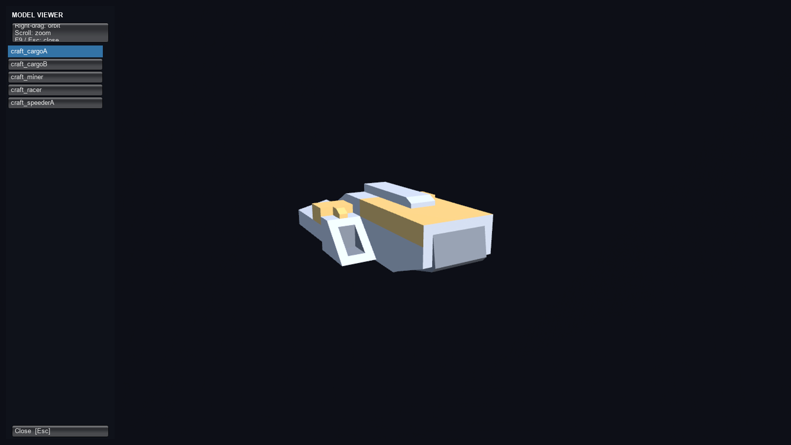
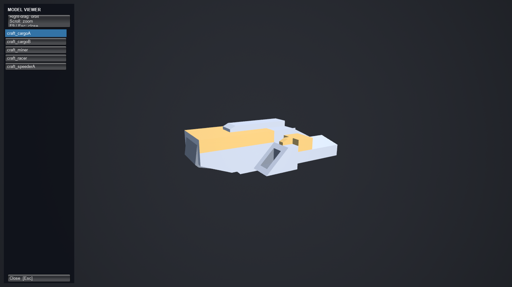
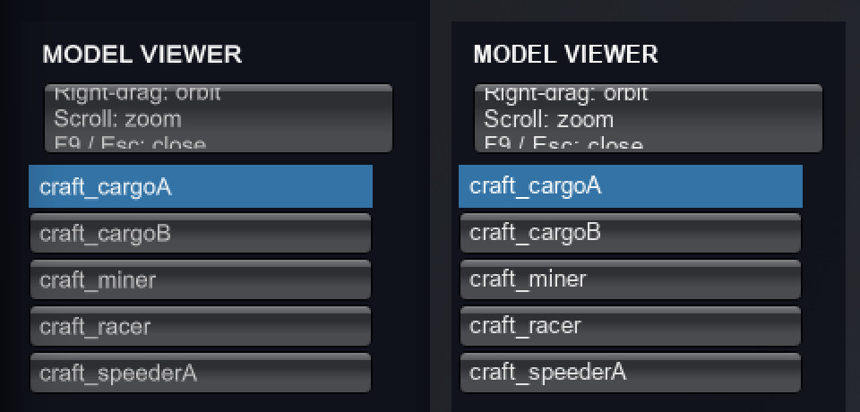

# Faithfulness audit: both remakes against Unity.SpaceGod (US-T48)

The goal is a perfect replica of Unity.SpaceGod in C++ (`Cpp/`) and in C# (`CSharp/`). This audit checks every feature
the original ships against both tracks. The checklist comes from the original's `docs/USER_STORIES.md` (the 166 closed
feature stories and the fixes that changed behaviour), `Core/GameManual.cs` (its 14 chapters), `Core/ControlsHelp.cs`
(every binding), `docs/VISION.md` and the design docs (BOARDING, EMBODIMENT, FLIGHT_MODELS, SHIP_ROSTER, MODULAR_SHIPS,
NEAREST_STARS, RENDER_PIPELINES_SPIKE). Its 15 open stories (civ dynamics, U.SPC-T396 to T438) are not in the original
yet, so they are not checked here.

Each track is checked two ways: by reading the code (is the original's code there and reachable, does the engine side
wire it?), and by running it headless wherever a script can drive it.

## Legend

| Mark | Meaning |
|---|---|
| ✓R | verified by a run on this track (`-Mode audit`, `smoke`, `views`, `shots`, `demo`, `fidelity`, `coop-smoke`, or the Bench's Core parity) |
| ✓C | code present and wired (the original's code path is there and reachable), not exercised by a run |
| ✗ | missing |
| ≠ | divergent (described in the note, with its fix ticket) |

## How each track relates to the original

- **C# track.** The Core is Unity.SpaceGod's own `Core/**/*.cs`, compiled unchanged. The Runtime files are the
  originals on a `UnityEngine` facade: 17 of the 56 Runtime files are byte-identical, and the rest differ only at lines
  marked `US-T26/T39/T41/T43/T47` (co-op hooks, Unity scene loading, save-statics priming, and `UnitySpaceApp.cs` split
  into `UnitySpaceApp.Helm.cs`). URP/HDRP (`Rendering/Pipeline/*`) became one `UnrealRenderBackend`. So **every Core
  and Runtime feature is code-present by construction**. Faithfulness then depends on the facade (UnityCompat), which
  is where the C# divergences are.
- **C++ track.** The Core is a file-for-file C++20 translation, **bit-identical to C#** on all five Bench scenarios
  (sol-idle, high-warp, economy-year, battle, galaxy-ftl; MIGRATION.md "Parity findings"). The Runtime is a translation
  of every original Runtime file. A method-level check (every method declared in the original's 56 Runtime files,
  768 in all, looked up by name in `Cpp/Source/UnrealSpaceGod`) finds **all 768 present**.
- **Both tracks** run the same UI tour (`-Mode smoke`: every main-menu page, New Game, the HUD and every HUD panel,
  galaxy map Diplomacy/Command, the pause menu's Settings/Display pages, Help with a chapter turn, each clicked by label)
  and the same views check (`-Mode views`: identical renderer, primitive and triangle counts). Deterministic
  screenshots of both (`-Mode shots`) differed by at most 4.9% of pixels, nearly all of it text rasterisation; since
  US-T54 draws the C# GUI through Slate as the C++ track does, at most 3.6% (Help 0.01%, galaxy map 0.02%; what is
  left is world labels and lines, MIGRATION.md "Visual parity").

## The binding audit (`tools/play.ps1 -Track <Cpp|CSharp> -Mode audit`)

`-SpaceGodAudit` runs after the smoke. `CSharp/Script/.../Runtime/Audit/FeatureAudit.cs` and
`Cpp/Source/UnrealSpaceGod/Smoke/FeatureAudit.cpp` run the same probes, in the same order, with the same ids. Each
probe presses one of the original's bindings on the scripted device the smoke already uses, then checks the state that
the original's handler changes. A probe also puts back what it changed, so one failure cannot cascade into the next.
`PASS` / `FAIL` count toward the result. `INFO` marks a key the original's handler answers silently for that hull (a
fighter has no lane to re-enter, no phasers, nothing to lock); those lines exist so the two tracks' logs can be compared
line by line.

Result (2026-11-03): **C#: 47 PASS, 0 FAIL, 5 INFO. C++: 47 PASS, 0 FAIL, 5 INFO.** The two logs match probe for
probe: same states, same toasts, same ships (SFS Resolute, then SFS Vanguard on Tab; SFS Practice Fighter on Shift+V).
The C++ figure is from the run just before `KeyToast` learned to log INFO; those same 5 probes were counted as FAIL
then and had identical toasts.

| Probe | Binding | C++ | C# |
|---|---|---|---|
| audio.volume / audio.mute; render.settings, render.pipeline, render.hdrp.* (6), render.urp.* (13) (US-T50, US-T51) | Settings > Master volume and the `-muted` mute; Settings > Render pipeline, each setting moved and put back | ✓R | ✓R |
| time.pause / time.warp / time.warp-alt / time.reset | Space; `.` `,`; `=` `-`; T | ✓R | ✓R |
| view.scale | G, `` ` `` | ✓R | ✓R |
| view.orbits / labels / lanes / satellites / reorient | O L N K R | ✓R | ✓R |
| view.sky | Shift+K, Shift+Alt+K | ✓R | ✓R |
| ui.help, ui.help-f1, ui.hud, ui.clear-screen | H, F1, U, F11 | ✓R | ✓R |
| ui.market / outfit / bounties / contracts / fleet / trade-desk | M F2 F4 F7 F10 `\` | ✓R | ✓R |
| ui.galaxy-map / news / spawn / saves / picker | `[` X V F6 F9 | ✓R | ✓R |
| ui.pause-menu | Esc (opens, time stops; Esc resumes) | ✓R | ✓R |
| nav.home / nav.number-focus / nav.cycle-ships / nav.watch-battle | Home; 3 then F; Tab; B | ✓R | ✓R |
| saves.quicksave / saves.quickload | F5 / F8 | ✓R | ✓R |
| helm.pilot / thrust / flight-assist / silent-running / cargo | P; W held; F; F3; I | ✓R | ✓R |
| helm.esc-pause-menu / helm.release | Esc at the helm; P | ✓R | ✓R |
| helm.practice-fighter / helm.ftl-plot / helm.ftl-autopilot | Shift+V; PgDn; End | ✓R | ✓R |
| helm.ftl-engage / lane-reenter / phasers / run-hot / lock (INFO) | Enter; Y; Insert; Shift+Insert; T | same on both | same on both |
| seats.man-gun / back-to-command / take-charge | `/`; P; `'` | ✓R | ✓R |
| diplomacy.hail | F12 | ✓R | ✓R |
| render.msaa / display.modes / display.exclusive-rate (US-T55, US-T56) | Settings > MSAA off/on; Display page; Apply exclusive at the largest size | ✓R | ✓R |
| combat.mouse-aim / combat.mouse-fire (US-T58) | the mouse swinging the crosshair; T; the left button held | ✓R | ✓R |
| transit.lane-enter / transit.lane-ride (US-T58) | W held into an on-ramp's ring; the ride | ✓R | ✓R |
| transit.gate (US-T58) | W held into a gate's range; Y | ✓R | ✓R |
| transit.ftl-engage / transit.ftl-arrive (US-T58) | PgDn; End; the crossing | ✓R | ✓R |

US-T58 added the last four rows, the parts of play the binding probes left code-present (2026-11-04: **C#: 80 PASS,
0 FAIL; C++: 91 PASS, 0 FAIL** in all, the difference being other tickets' probes; the US-T58 rows are 7 PASS on each,
the same text on both). Each stages a hull where the probe needs it (Fleet.SpawnAt, as Shift+V and the spawn grid make
theirs, then selected and taken with P) and from there flies it on the scripted keys and mouse only:

- **combat.mouse-aim**: the practice fighter (Shift+V) with a pirate freighter 1.5 km out, 16° off the nose; one frame
  of each mouse axis finds which way it swings the free-aim crosshair, then mouse deltas bring it onto the target:
  16.2° to 0.26° in 6 frames on both.
- **combat.mouse-fire**: the target selected (a left-click's selection) and locked with T, the left button opens fire
  (the original's "Weapons free on the Audit Target", War.TryStartPlayerAttack). The fight puts the two sides at their
  stations 13-14 km apart, so the fighter runs in on W, under cruise (J) while more than 3 km out, and inside the guns'
  reach fires in bursts (held until the guns run hot, let go until they cool), the mouse keeping the crosshair on the
  lead (the target's relative velocity over the guns' muzzle speed). Passed when the freighter's hull, shields and
  subsystems lose integrity and this side's rounds reach its hull: on both, 12180 to 12012, rounds 11-12 m from it,
  0.71 km off. The run-in's length differs by run (13.32-14.38 km: the clock starts at the real now, so the stations
  differ a little run to run on either track).
- **transit.lane-enter / lane-ride**: a fighter 0.5 km outside the Venus ramp's ring, flown in on W (256 frames on
  both): "Into the Venus-Earth lane", ridden at the compressed clock (714 frames) to "Off the Venus-Earth lane at Earth",
  within 1 km of Earth's ramp.
- **transit.gate**: a fighter 0.5 km outside the Centauri Gate's activation range, across its spur so as not to thread
  the spur's ring, flown in on W ("In range of CENTAURI GATE to ALPHA CENTAURI (Y to activate)") and through on Y: in
  Alpha Centauri at the helm of the hull that came out, in that system's fleet ("Jumped to ALPHA CENTAURI through the
  gate", then the Sol Gate beside it in range).
- **transit.ftl-engage / ftl-arrive**: an explorer beside that hull; PgDn plots Luhman 16 (3.58 ly), End engages the
  autopilot, the drive spools and the crossing starts 281 frames on; 2650 frames later it drops out "at the edge of
  LUHMAN 16, 2.00 AU from its star (in from Alpha Centauri)", the helm back in hand.

**Fixed on both tracks (an original bug):** the player's own gate transit threw on every frame from the jump on, in
the original as in both ports (the C# track's Runtime is the original's file; the C++ track translates it). Activate
on the far system runs Galaxy.Promote, which steps that system's fleet; the hull GateTransit.TryPerform had just parked
there (DestinationBody -1, its phase already over) was not yet the far world's piloted ship, so it departed for body -1
and BodyCatalog's indexer threw (ArgumentOutOfRange / cs::List "index"), leaving the switch half done. UpdateGateActivation
now makes it the far world's piloted ship before Activate (UnitySpaceApp.Helm.cs and UnitySpaceApp.Main2.cpp, one line
marked US-T58); the rest of the original's code path is unchanged.

Before the audit settles on the camera's own pace, it can catch the camera mid-flight: in the first C++ run,
nav.home and nav.number-focus read `Travel` because only 30 frames had passed. That was a probe artefact, not a port
bug; the probes now wait for the flight to end (both tracks then read `Focus`).

## Checklist

Sources: **CH** = ControlsHelp binding, **GM** = GameManual chapter, **US** = U.SPC story, **V** = VISION.md.

### Navigation and camera

| Feature | Source | C++ | C# | Notes |
|---|---|---|---|---|
| Free swim (WASD, Q/E, C/]) | CH, GM "The god view" | ✓R | ✓R | smoke: W held moves the camera the same distance on both |
| Shift boost, Ctrl fine, wheel speed/zoom | CH | ✓C | ✓C | |
| Right-drag look / orbit | CH | ✓R | ✓R | smoke: 21.6° on both |
| Left-click select, double-click focus | CH | ✓C | ✓C | world picking not scripted; IMGUI clicks are (smoke) |
| F focus, Home system view, 1-9/0 planets | CH | ✓R | ✓R | audit nav.* |
| Tab cycle ships, B watch a battle | CH | ✓R | ✓R | audit (no battle under way at the probe: the original's toast) |
| G / `` ` `` gameplay vs realistic scale | CH, US | ✓R | ✓R | |
| R auto-reorient (U.SPC-T268) | CH, US | ✓R | ✓R | |
| Dynamic near plane, FOV kick under boost/cruise (U.SPC-T12) | US | ✓R / ✓C | ✓R / ✓C | near plane matched in the shots (US-T45) |
| Star travel: STAR SYSTEMS navigator, warp lines, gate fly-through (U.SPC-T266, T277) | CH, US | ✓R | ✓R | coop-smoke party trip to Alpha Centauri on both tracks |

### Time

| Feature | Source | C++ | C# | Notes |
|---|---|---|---|---|
| Eased pause (Space / Pause) | CH, US-T21 | ✓R | ✓R | |
| Time warp (`.` `,` `=` `-` numpad) | CH | ✓R | ✓R | |
| T back to now | CH | ✓R | ✓R | |
| Pause menu stops time (Time.timeScale) | US-T276 | ✓R | ✓R | |

### Bodies, systems and the galaxy

| Feature | Source | C++ | C# | Notes |
|---|---|---|---|---|
| Ephemeris, Sol's bodies, moons, rings, orbits | GM, US | ✓R | ✓R | Core parity; views check counts identical |
| Nearest real systems, 123 to 100 ly (U.SPC-T54, T454, T456) | US, NEAREST_STARS | ✓R | ✓R | Core parity (galaxy build digest) |
| Asteroid belt on the GPU, Trojans, Lagrange points (U.SPC-T96) | US | ✓C | ✓R | C#: fidelity shots and the smoke log; C++ AsteroidBelt packs the same GPU field |
| Multi-system simulation with level of detail (U.SPC-T104) | US | ✓R | ✓R | Bench high-warp |
| Skyboxes per system (Shift+K, U.SPC-T595) | CH, US | ✓R | ✓R | |
| Interstellar stars, starfield, sky | GM | ✓R | ✓R | views check |

### Ships, the helm and flight

| Feature | Source | C++ | C# | Notes |
|---|---|---|---|---|
| Take / hand back the helm (P) | CH, US-T19 | ✓R | ✓R | audit; the coop-smoke flies a helm too |
| Per-family flight models (fighters, heavy fighters, haulers, capitals) (U.SPC-T17, T269, T440-T443, T499) | US, FLIGHT_MODELS | ✓R | ✓R | audit: a capital's thrust; coop-smoke: a freighter flown on the client's input |
| Flight assist (F), Newtonian drift (U.SPC-T59) | CH, US | ✓R | ✓R | |
| Strafe, roll Z/X, cruise J, docking mode Ctrl | CH | ✓C | ✓C | |
| Spawn & Pilot grid (V) with hull thumbnails (U.SPC-T24) | CH, US | ✓R | ✓R | panel by key (audit) and drawn (smoke); C# thumbnails also in the fidelity shots |
| Practice fighter (Shift+V, U.SPC-T601) | CH, US | ✓R | ✓R | |
| Silent running (F3), sensors and signatures (U.SPC-T66) | CH, US | ✓R | ✓R | |
| Grid cargo hold (I, U.SPC-T5) | CH, US | ✓R | ✓R | |
| Collisions and ramming (U.SPC-T60) | US | ✓C | ✓C | |
| Ship roster, modular hulls, hardpoints (SHIP_ROSTER, MODULAR_SHIPS, U.SPC-T377, T470, T508) | US | ✓R | ✓R | Core parity; every hull's model in the views check |
| Engine exhaust particles (U.SPC-T13) | US | ✓C | ✓C | ParticleSystem facade on both |

### Combat, boarding and fighters

| Feature | Source | C++ | C# | Notes |
|---|---|---|---|---|
| Battles, kinetic travel time, beams, shields by emitter, armour angling | US-T38, T501, T533, T534 | ✓R | ✓R | Bench `battle` scenario bit-identical |
| Guns down the crosshair, T lock, missiles, EMP, mines | CH, GM "Combat and boarding" | ✓R | ✓R | audit combat.mouse-aim / mouse-fire: the crosshair on the mouse, T, the left button, hits (US-T58); coop-smoke: a fighter's cockpit keys (7, F, Ctrl) on both |
| Phasers (Insert), run hot (Shift+Insert), roll weak patches (Shift+Del) | CH | ✓C | ✓C | audit INFO: a fighter has none; silent on both |
| Capital broadside and captain's orders (1-0) (U.SPC-T272, T425) | CH, US | ✓C | ✓C | |
| Boarding: shuttles, Breacher rounds, compartments, B panel (BOARDING.md) | CH, US | ✓R / ✓C | ✓R / ✓C | Core in the battle scenario; the B panel not scripted |
| Surrender, ransom, escape pods, prisoners (U.SPC-T46, T63, T64) | US | ✓R | ✓R | Core parity (high-warp) |
| Wrecks, debris fields, salvage (U.SPC-T39, T45) | US | ✓R | ✓R | demo tour on both (the C++ tour since US-T58) |
| Battle FX, shield bubbles, muzzle flash (U.SPC-T38, T40) | US | ✓R | ✓R | demo tour combat showcase on both (the C++ tour since US-T58) |

### Embodiment seats (take charge)

| Feature | Source | C++ | C# | Notes |
|---|---|---|---|---|
| `'` / `;` next seat in the fight in view (U.SPC-T422) | CH, EMBODIMENT | ✓R | ✓R | audit: the original's "No battles under way" path |
| `/` man a gun, Backspace up to the helm (U.SPC-T445) | CH | ✓R | ✓R | audit (refusal path); coop-smoke takes a station seat on both |
| F9 take-charge picker (U.SPC-T446) | CH | ✓R | ✓R | |
| Stations, satellites as seats (U.SPC-T447, T448) | US | ✓R / ✓C | ✓R / ✓C | coop-smoke: Earth's defence platform on both |
| Fighter cockpit seats | US-T424 | ✓R | ✓R | coop-smoke |

### FTL, gates and lanes

| Feature | Source | C++ | C# | Notes |
|---|---|---|---|---|
| Jump gates (Y), gate network, construction (U.SPC-T8, T55, T97) | CH, US | ✓R / ✓C | ✓R / ✓C | network in Core parity; audit transit.gate: flown into range, Y to Alpha Centauri (US-T58, with the original's crash on arrival fixed on both); construction not scripted |
| Hyperlanes ridden by the player, interdiction (U.SPC-T41, T42) | CH, US | ✓R / ✓C | ✓R / ✓C | audit transit.lane-enter / lane-ride: in through the Venus ramp's ring on W, ridden to Earth (US-T58); interdiction not scripted |
| Own-power FTL: plot (PgDn/PgUp), clear (Del), autopilot (End), engage (Enter) (U.SPC-T417-T420) | CH, US | ✓R | ✓R | audit transit.ftl-engage / ftl-arrive: an explorer, PgDn and End, out, spooled, across to Luhman 16 and dropped out (US-T58); helm.*: the original's refusals for a fighter, identical text |
| Interstellar traffic, war and piracy across gates | US-T92, T94 | ✓R | ✓R | Bench galaxy-ftl and high-warp |

### Economy, trade, colonies and mining

| Feature | Source | C++ | C# | Notes |
|---|---|---|---|---|
| Market board: buy, sell, refuel (M) | CH, US-T6 | ✓R | ✓R | panel by key; the coop-smoke buys a crate at Earth on both |
| Trade desk (`\`), charters, insurance | CH | ✓R | ✓R | panel |
| Contracts board (F7) | CH, US-T101 | ✓R | ✓R | panel |
| Outfitting (F2) | CH, US-T65 | ✓R | ✓R | panel |
| Economy simulation: production, people, propellant, companies, colonisation, mining pipeline | US-T31-T33, T56, T57, T98, T99, T330 | ✓R | ✓R | Bench economy-year bit-identical |

### Law, outlaws, diplomacy, events and news

| Feature | Source | C++ | C# | Notes |
|---|---|---|---|---|
| Bounty board (F4), law, crime, named outlaws (U.SPC-T61-T63) | CH, US | ✓R | ✓R | panel; the simulation in Core parity |
| Hail a polity (F12), diplomacy screens (U.SPC-T427) | CH, US | ✓R | ✓R | audit (a hail opens the envoy on the galaxy map); smoke: Diplomacy and Command pages |
| Strategy layer: production, research, objectives (U.SPC-T423) | US | ✓R | ✓R | smoke (Command page); coop-smoke drives the orders on both |
| Dynamic events, distress calls, adventures (U.SPC-T44) | US | ✓C | ✓C | Core in parity; HUD markers not scripted |
| News feed (X), market shocks (U.SPC-T58) | CH, US | ✓R | ✓R | |

### Fleet and command

| Feature | Source | C++ | C# | Notes |
|---|---|---|---|---|
| Fleet panel (F10): hulls, warehouses, shares, captains, orders (U.SPC-T102) | CH | ✓R | ✓R | panel |
| Galaxy map (`[`) (U.SPC-T103) | CH | ✓R | ✓R | |

### Saves and profiles

| Feature | Source | C++ | C# | Notes |
|---|---|---|---|---|
| Quicksave F5 / quickload F8 | CH, US-T67 | ✓R | ✓R | audit; smoke's save/load round trip |
| Save slots (F6) | CH | ✓R | ✓R | panel |
| Autosave every 5 min and on quit, `-continue` | CH | ✓C | ✓C | |
| Profiles: per-profile folders, Main Menu > Profiles (U.SPC-T325, T327) | US | ✓R | ✓R | smoke |
| Saves readable across the two tracks | (port) | ✓C | ✓C | SaveCompat (US-T41) |

### Settings and display

| Feature | Source | C++ | C# | Notes |
|---|---|---|---|---|
| Settings registry and page (U.SPC-T431) | US, V | ✓R | ✓R | smoke: pause > Settings |
| Display: aspect, resolution, window mode, VSync (U.SPC-T276, T284) | US | ✓R | ✓R | the monitor's modes at their real refresh rates (DXGI), exclusive fullscreen switched to the chosen rate (US-T56); audit display.modes, display.exclusive-rate |
| Frame cap | GM "Settings" | ✓C | ✓C | t.MaxFPS on both |
| MSAA setting | GM "Settings" | ✓R | ✓R | 4x MSAA on the forward renderer, Unity's 1.4-px MSAA lines (US-T55); audit render.msaa; an orbit line's light per column: original 0.201, C++ 0.199, C# 0.198 (FXAA was 0.071) |
| Render pipeline choice, HDRP options, URP post-processing (U.SPC-T429-T431, T451) | US | ≠ | ≠ | both: the same 20 settings in Settings > Render pipeline, kept per profile, the URP look on Unreal's post-process (exposure and the physical camera as a colour gain, bloom, the tone curve, grading, the star glare); the pipeline choice kept but restarting nothing and HDRP's options kept only, as Unreal has one renderer (US-T51); audit render.*: 21 rows, identical on both tracks |
| Master volume | GM "Settings" | ✓R | ✓R | on Unreal's primary volume (US-T50); audit audio.volume |

### UI screens

| Feature | Source | C++ | C# | Notes |
|---|---|---|---|---|
| Main menu: Continue, New Game, Profiles, Settings, Help, Asset Library POC, Quit | US-T327 | ✓R | ✓R | smoke |
| Help screen and the in-game manual (14 chapters) (U.SPC-T494, T497) | GM | ✓R | ✓R | smoke turns a chapter |
| HUD on/off (U), clear the screen (F11) (U.SPC-T496) | CH | ✓R | ✓R | |
| Navigator collapsed by default, marquee lines (U.SPC-T328, T495) | US | ✓R | ✓R | HUD drawn in smoke and shots |
| Pause menu: Resume, Help, Save/Load, Settings > Display, Main Menu, Quit | CH, US-T276 | ✓R | ✓R | |
| Text fields (profile and save names) | US-T327 | ≠ | ✓C | C++: append and backspace only (**US-T52**) |
| Text clipped at scroll and clip edges | (IMGUI) | ✓C | ✓R | C#: drawn through a Slate overlay with clipping zones, glyphs cut at the edge; icons with Unity's mip chain (US-T54; shots: the clipped panels match the C++ shot, 22% → 0.04% of pixels) |
| Unity default skin (ModelViewer, asteroid labels, default scrollbars and sliders) | (IMGUI) | ✓R | ✓R | Unity's own GameSkin, read from the original player (`tools/unity_extract.py`); model viewer panel 4.76% (C++) / 4.87% (C#) of pixels differing from the original player's, all text rasterisation (US-T57) |

### Rendering features

| Feature | Source | C++ | C# | Notes |
|---|---|---|---|---|
| Bodies, rings, atmospheres, the 26 shaders as M_* materials | US | ✓R | ✓R | views check; shots |
| Line strips (orbits, lanes), 1-px stars | US | ✓R | ✓R | US-T45 fixes; views diff 2 px in 1.44 M |
| Kenney craft and procedural hulls, LOD, far icons (U.SPC-T376, T415) | US | ✓R | ✓R | views check |
| Model viewer (F9 / `-modelviewer`) | US-T24, T111 | ≠ | ✓R | C++: camera depth and culling mask not rendered (**US-T53**) |
| Ship thumbnails (offscreen capture) | US-T24 | ✓C | ✓R | |
| Lights, PBR for imported glTF | (URP) | ✓R | ✓R | Lights light only URP Lit (as under URP); the glTF hulls draw with M_Lit, URP 17's PBR; C# hull 2.05% of pixels from the original's (US-T57; C++: lit and shaded alike, seen from the other side, US-T53) |
| Scene tour (`-demo`) and capture (`-capture`) | US-T10, T15 | ✓R | ✓R | all 55 stops captured on both (`play.ps1 -Mode demo -Track Cpp` since US-T58, which counts the stops; the C++ runner now takes `-capturedir` as the C# one does). The C++ tour's first stop is shot while the engine is still compiling shaders ("Preparing Shaders"), so Earth is not yet drawn in it |

### Audio

| Feature | Source | C++ | C# | Notes |
|---|---|---|---|---|
| Sound playback | (Runtime) | ✓C | ✓C | the original has no clips and no AudioSource: nothing is played in any of the three |
| AudioListener master volume and the `-muted` CLI mute (U.SPC-T536) | US | ✓R | ✓R | both set Unreal's primary volume, 0 under the mute whatever the setting (C#: UnrealHost through sg.SetPrimaryVolume, US-T50); audit audio.volume, audio.mute |

## Totals

The 88 rows of the checklist above (a row with two marks, such as `✓R / ✓C`, is counted under its first):

| Track | ✓R | ✓C | ✗ | ≠ |
|---|---|---|---|---|
| C++ | 71 | 14 | 0 | 3 |
| C# | 74 | 13 | 0 | 1 |

Binding audit: 47 PASS, 0 FAIL on each track.

## Fix tickets (ref US-T48)

| Ticket | Track | Gap |
|---|---|---|
| US-T50 | C# | the master volume and `-muted` never reach Unreal (fixed: UnrealHost applies AudioListener.volume, sg.SetPrimaryVolume) |
| US-T51 | C# | Render Pipeline and Post-processing settings missing (fixed: ported, on Unreal's post-process as on the C++ track) |
| US-T52 | C++ | GUI.TextField has no TextEditor (caret, selection, clipboard) |
| US-T53 | C++ | the model viewer camera's depth and culling mask are not rendered |
| US-T54 | C# | IMGUI text clipped by whole glyphs; icons without mips (fixed: Slate overlay, mip chain) |
| US-T55 | both | MSAA setting is FXAA (deferred renderer) (fixed: forward renderer, 4x MSAA, MSAA line width) |
| US-T56 | both | display modes all at 60 Hz (fixed: DXGI's modes and rates, the rate set in exclusive fullscreen) |
| US-T57 | both | Light components data only, glTF without PBR, default skin approximated (fixed: Lights on URP Lit, M_Lit, Unity's GameSkin) |

## US-T57: the model viewer against the original player

`Unity.SpaceGod/Builds/Windows/Unity.SpaceGod.exe -screen-width 1600 -screen-height 900 -screen-fullscreen 0 -capture
-modelviewer craft_cargoA` (the window's client area captured) against each track's `tools/play.ps1 -Mode fidelity`
model viewer shot (the same model, orbit and zoom), `tools/imgdiff.py` (any channel > 24/255), by region:

| Region | C# before | C# after | C++ after |
|---|---|---|---|
| hull (pixels the original draws off the backdrop) | 96.70% | 2.05% | 80.26% (seen from the other side: US-T53) |
| panel (box, label box, buttons, scroll view) | 8.05% | 4.87% | 4.76% |
| whole frame | 4.64% | 64.96% | 67.85% |

The hull's faces now match the original's within 1-2 levels (e.g. (100, 113, 134) → (99, 113, 133), (254, 215, 141) →
(253, 215, 140)); before, M_Ship drew it near black. What is left in the panel is text rasterisation. The whole-frame
figure is the camera's SolidColor backdrop, not US-T57: the uncommitted exposure work in the shared tree (US-T51/T55)
lifts it from Unity's flat (13, 15, 23) to about (40, 43, 50) on both tracks (noted on US-T51).

| Original player | C# | C++ |
|---|---|---|
|  |  |  |

## Not covered by a run yet

US-T58 ran the mouse-driven fight at the helm, the player's own lane, gate and FTL transits and the C++ `-demo` tour
(above). Still code-present only: mouse-driven world picking (a left-click on a hull or a world; the combat probe
selects its target as that click does), a capital's broadsides and captain's orders, boarding orders, lane
interdiction, gate construction.
