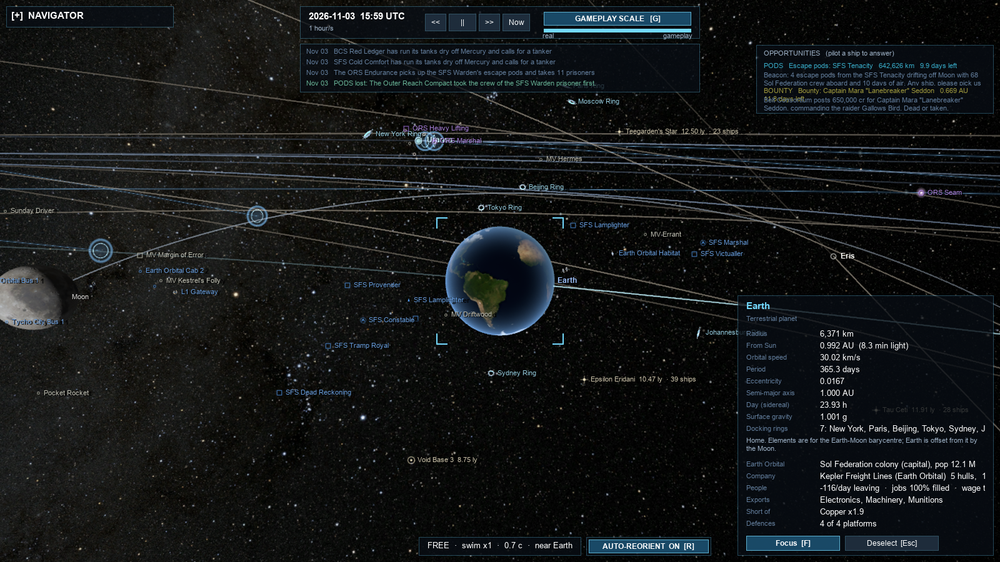

# Unity.SpaceGod → Unreal.SpaceGod migration

Goal (US-T4): a **perfect replica of Unity.SpaceGod in Unreal Engine 5.8, built twice** — once in native C++,
once in C# — both **co-op**, then raced against each other to see whether either has a real advantage.

| Track | Folder | Packaged exe | Core simulation | Engine side |
|---|---|---|---|---|
| C++ | `Cpp/` | `Unreal.SpaceGod.Cpp.exe` | `Cpp/Source/SpaceGodCore/`: Unity.SpaceGod's Core translated file-for-file to C++20 against `Cs/Cs.h` | `Cpp/Source/UnrealSpaceGod/`: UE C++ (rendering, HUD, input, camera, co-op) |
| C# | `CSharp/` | `Unreal.SpaceGod.CSharp.exe` | Unity.SpaceGod's own `Assets/UnitySpace/Core/**/*.cs`, compiled unchanged (as its `Tests/UnitySpace.Core` csproj does) | UnrealSharp (C# in UE5): the Runtime layer rewritten for Unreal in C# |
| Bench | `Bench/` | `Bench.Cpp.exe`, `Bench.CSharp.exe` | Headless runners over the two Cores | Same scenarios, same seeds; compare state hashes and timings |

The source of truth is **Unity.SpaceGod** (`D:\Projects\MindAttic\Unity.SpaceGod`, cloned next to this repo),
plus its dependency **Unity.Shared** (`Runtime/Core`: JSON and player profiles). Faithful-port rule: reproduce
the original's behaviour; fix only genuine bugs (note each one on the ticket); never change or "improve"
gameplay. Co-op is the one addition, and it goes through the original's own Session layer (`Core/Session`:
`ISession`, `Commands`, `CommandCodec`, `SeatAuthority`), with the host running the authoritative simulation.

## The C++ Core: translation rules

The C++ Core must run **the same simulation bit for bit** as the C# Core, so the Bench can compare their
state after N ticks. That is why the translation is mechanical and why `Cs/Cs.h` reproduces .NET exactly.

**Layout.** `Assets/UnitySpace/Core/<Dir>/<Name>.cs` → `Cpp/Source/SpaceGodCore/<Dir>/<Name>.h` + `.cpp`.
Partial classes (`World.cs`, `World.Mining.cs`, …) share one header (`World.h`) and keep one `.cpp` per C# file.
Includes are rooted at the module: `#include "Combat/Battle.h"`, `#include "Cs/Cs.h"`.
Everything lives in `namespace SpaceGod::Core` (`Unity.Shared.Core` → `namespace SpaceGod::Shared`).
No Unreal headers anywhere in SpaceGodCore except `SpaceGodCoreModule.cpp`. No `using namespace` in headers.

**Names are kept exactly**, so a file ported by one agent compiles against a file ported by another without
either seeing the other's work. Decide every name *from the C# declaration alone*:

| C# declaration | C++ |
|---|---|
| class / sealed class | `class Name` (`final` if sealed); held as `cs::Ref<Name>` (shared_ptr). `new Foo(a)` → `cs::New<Foo>(a)` |
| abstract class / interface `IFoo` | abstract class with pure virtuals, same name (`IFoo`); implementers inherit publicly |
| struct / readonly struct | `struct Name` held by value; every field default-initialised (`double X = 0;`) as C# zeroes it |
| record (class) | `class` with value equality: `bool operator==` + `size_t HashCode() const`; held as `cs::Ref` |
| record struct | `struct` with `operator==` + `HashCode()` |
| enum | `enum class Name : int` with the same members and values, plus `const char* ToString(Name)` returning the member name (C#'s enum ToString). `[Flags]`: also `CS_FLAGS(Name)` (bitwise operators) |
| static class | `namespace`-scoped class with only `static` members (keep it a class: callers write `Foo::Bar()`) |
| field (any visibility) | field, same name |
| auto-property `{ get; }` `{ get; set; }` `{ get; private set; }` `{ get; init; }` | **field**, same name |
| property with a body (`=> expr`, `get { … }`) | **method** `Name()` (const); a bodied setter → `SetName(value)` |
| expression-bodied / normal method | method, same name |
| indexer `this[int i]` | `operator[](int)` |
| `event Action<A, B> Name` | `cs::Event<A, B> Name;` — `Name?.Invoke(a, b)` → `Name.Invoke(a, b)`; `Name += h` → `Name += h` |
| `const` / `static readonly` of a simple type | `static constexpr` / `static inline const` |
| `static readonly` of a class/collection | a static function returning a function-local static (`static const List<X>& Xs()`), called as `Xs()` — C# initialises statics lazily per type; this avoids C++'s cross-file init order |
| nested type `Outer.Inner` | nested `Outer::Inner` |
| `out T x` / `ref T x` / `in T x` | `T& x` / `T& x` / `const T& x` |
| `T?` (value type) | `cs::Nullable<T>`; `x ?? y` → `x.value_or(y)`; `x.HasValue` → `x.has_value()`; `x.Value` → `*x` |
| class reference null | `nullptr`; `a?.B` → `(a ? a->B : default)`; `a ??= b` → `if (!a) a = b;` |
| `is T t` / `as T` | `if (auto t = cs::As<T>(x))` |
| `List<T>`, `T[]`, `IReadOnlyList<T>`, `IList<T>` | `cs::List<T>` (by value for a member; `const cs::List<T>&` for an `IReadOnlyList` parameter/return of a member) — note a C# list is a reference: where C# code **shares** one list between objects, hold `cs::Ref<cs::List<T>>` |
| `Dictionary<K,V>`, `IReadOnlyDictionary` | `cs::Dictionary<K,V>` (enumerates in .NET order — required for parity) |
| `HashSet<T>`, `Queue<T>`, `Stack<T>` | `cs::HashSet<T>`, `cs::Queue<T>`, `cs::Stack<T>` |
| `IEnumerable<T>` + `yield return` | return a `cs::List<T>` built eagerly — **unless** the C# relies on laziness (stops early with `First`/`Any`, infinite, or side effects interleaved with the caller); then write a callback form `void ForEachX(Func<T,bool> visit)` and note it |
| `Func<…>` / `Action<…>` | `cs::Func<R, A…>` / `cs::Action<A…>` (std::function) |
| `new Random(seed)` | `cs::Random(seed)` (bit-exact .NET sequence) |
| `Math.X` / `double.X` / `int.MaxValue` | `cs::Math::X` / `cs::Double::X` / `cs::Int::MaxValue` — **always** these, never `std::` directly: Math.Round is banker's rounding and Math.Max propagates NaN |
| `(int)someDouble` | `cs::ToInt(someDouble)` (C++'s cast is undefined for NaN/out of range) |
| `unchecked(a * b)` on ints | `cs::WrapMul(a, b)` etc. Unsigned `uint`/`ulong` arithmetic wraps natively: use `uint32_t`/`uint64_t` |
| `x.ToString()` / `"a" + x` / `$"{x}"` | `cs::Str(x)` / `cs::Cat("a", x)` |
| `x.ToString("0.##", Invariant)` / `$"{x:0.0}"` | `cs::Fmt(x, "0.##")` |
| string methods | `cs::Strings::Join/Substring/StartsWith/...`; `s.Length` → `static_cast<int>(s.size())`; `==` is ordinal |
| `throw new ArgumentOutOfRangeException(...)` | `throw cs::ArgumentOutOfRangeException(cs::Cat(...))` |
| `list.Sort(cmp)` | `list.Sort(cmp)` (port of .NET's unstable introsort); LINQ `OrderBy` → `cs::OrderBy` (stable) |
| LINQ elsewhere (`Where/Select/Any/All/Max/Sum/Count(pred)`) | an explicit loop with the same semantics and the same order |
| `foreach` over a collection that the body mutates | C# would throw; the original doesn't do it — keep the same iteration |
| `lock`, `Interlocked`, `Thread.Yield`, `Task` | `std::mutex`, `std::atomic`, `std::this_thread::yield`, `std::thread`/`std::async` |
| `System.IO` | `std::filesystem` + `std::fstream`; `GZipStream` (one use) → see Persistence ticket |
| reflection (`ObjectGraph`) | hand-written: see Persistence ticket |

**Comments.** Keep every XML doc comment and inline comment, as `///` or `//`, so the port stays reviewable
side by side with the original.

**Headers.** Forward-declare classes you hold by `cs::Ref`; include a header only for by-value members, base
classes and inline code. Constructors keep C#'s parameters and default arguments. Field initialisers move to
default member initialisers in the same order (C# runs them before the constructor body, in textual order).

**Conventions settled during wave 1** (apply them too):
- C# tuples `(A a, B b)` → `std::tuple<A, B>` (or a small named struct when the C# names the elements and callers use the names); `T?` of a tuple → `cs::Nullable<std::tuple<…>>`.
- A `string` that C# compares with `null` → `cs::String`, with empty standing for null (note it where null and "" mean different things).
- A partial class spread over several C# files (e.g. `Battle` extended by `BoardingShuttles.cs`): the file that adds members writes their bodies in its own `.cpp` and lists the exact declarations in a comment at the top of its header; the integration ticket adds them to the main class header.
- A class that passes `this` as a C# reference (`Foo(this)`) → inherit `std::enable_shared_from_this<T>` and pass `shared_from_this()`.
- `[SettingsSource]` and other attribute-reflection discovery → explicit registration; list what the integration ticket must call.
  Settings (US-T21): `SettingsRegistry::DiscoverLoadedDeclarations()` is defined in `Settings/SettingsSources.cpp`, an explicit
  list touching every Core `[SettingsSource]` class in C#'s discovery order (the folder's own files, then subfolders, alphabetically;
  declaration order within a file): its `RunClassConstructor()` where the port has one, else each setting accessor in C# field
  order. A new Core settings source is added to that list; the engine side adds its own with
  `SettingsRegistry::AddDeclarationSource(touch)`. A setting registers itself from its constructor, as in C#: the registry
  holds it non-owning until its next read, then adopts the owning `cs::Ref` (`weak_from_this`), so `cs::New<RangeSetting>(…)`
  in a function-local static stays the way to declare one.
- An interface's properties (and an implementer's, even auto-properties) → pure virtual / overriding methods `Name()`; an
  interface event → a virtual accessor returning the implementer's `cs::Event` (`session->EventRaised() += h`). C# structs
  used through an interface (Session's commands and events) → structs deriving from it, passed as `cs::Ref<IFoo>` (the box).
- Classes that override `Equals`/`GetHashCode` and are compared through an interface (the `IEmbodiable` seats): virtual
  `Equals(const cs::Ref<I>&)` / `GetHashCode()` on the interface, plus a key wrapper with `operator==`/`HashCode()` for
  `cs::Dictionary` and explicit loops for `List.Contains`/`IndexOf` (`Embodiment/Embodiment.h`).

**Evaluation order (parity-critical).** C# evaluates operands and call arguments strictly left to right;
C++ does not (argument order is unspecified, `a() + b()` may run `b` first). Wherever two or more operands or
arguments of one expression have side effects — above all `rng.Next…()` draws, but also counters, queue
pops, list adds — hoist them into locals in C#'s left-to-right order first:
`double x = rng.NextDouble(); double y = rng.NextDouble(); DVec3(x, y, …)`.

**Don't compile in the porting waves** (memory is shared by many agents): write the files faithfully, then
the integration ticket compiles all of SpaceGodCore and fixes the seams. If a referenced C# member's shape is
ambiguous, read its declaration in Unity.SpaceGod and apply the table above; if still unclear, note it on
your ticket.

## Foundation (US-T5): Cs runtime, builds, Shared

**What `Cs/` gives you beyond the table** (all in `Cs/Cs.h`, which also pulls in `Cs/CsSort.inl` and
`Cs/CsDateTime.h`): `CS_FLAGS(E)` after a `[Flags] enum class` (bitwise operators; `cs::HasFlag(v, f)`,
`cs::Any(v)` for `!= 0`); `cs::Single::NaN/MaxValue/…`, `cs::Long::MinValue/MaxValue`; `cs::CompareTo(a, b)`
(double.CompareTo: NaN equal to NaN and below every number) and `cs::Compare` (Comparer<T>.Default, which
`OrderBy` and `List.Sort()` use); mixed-type `Math::Max/Min/Clamp` (`Max(0, d)` is a double, as C# promotes);
`cs::Mod(a, b)` for C#'s `%` on doubles; `List::GetRange`; `List<bool>` that hands out a real `bool&`;
`cs::Delegate<A…>` for a plain Action *field* chained with `+=` (`d = h` replaces, `if (d)` is the null check;
`event`s stay `cs::Event`); equality comparers on Dictionary/HashSet as the third template argument
(`cs::Dictionary<String, V, cs::OrdinalIgnoreCaseComparer>`); `std::pair`/`std::tuple` keys; `cs::Format(
"{0:0.###} {1,5}", a, b)` for `string.Format`; `cs::DateTime` / `cs::TimeSpan` (BCL properties are methods —
`t.TotalDays()`, `d.Ticks()`, `DateTime::UtcNow()` — and BCL static fields are static members —
`DateTime::MaxValue`, `TimeSpan::Zero`; .NET 7+ arithmetic, ToBinary/FromBinary, invariant ToString formats);
`OverflowException`, `NullReferenceException`, `IndexOutOfRangeException`.

**Exact .NET behaviours to know.** `cs::Double::NaN` has .NET's bits (0xFFF8…, what `0.0/0.0` gives).
Standard formats with a precision (`F2`, `N0`, `P0`, `E3`, `G6`) round the exact binary value with ties to
*even* (`0.125.ToString("F2")` is `"0.12"`, `2.5.ToString("F0")` is `"2"`); custom formats (`"0.##"`) first take
15 significant digits (7 for float), then round half away from zero (`1.005` → `"1.01"`). `ToString()`/`"R"` is
shortest round-trip with E notation past 17 digits of exponent (`1E+17`, but `10000000000000000`). Everything is
the invariant culture: `P0` prints `"50 %"`, so the **C# track must run with `CultureInfo.InvariantCulture`** as
its current culture (Core's `$"{x:P0}"` uses the current culture). `Math.Round` is ToEven. `List.Sort` is
.NET's introsort (unstable) step for step. A non-const `Dictionary::operator[]` *inserts* a default when the
key is missing (that is the C# setter); where C# reads `dict[k]` expecting a throw, use `At(k)` or the const
indexer, or the insertion changes enumeration order.

**DLL exports.** In UE's editor build SpaceGodCore is a DLL, so everything another module calls must be
exported: put `SPACEGODCORE_API` on every non-template class or free function that is *defined in a .cpp*
(`class SPACEGODCORE_API Fleet`, `SPACEGODCORE_API double Foo(...)`). Cs/ and Shared/ do; the porting waves were
written without it, and the integration ticket adds it (scriptable: every `class`/`struct` with out-of-line
members in a header). It is empty in standalone and monolithic builds. Don't export a class derived from
`cs::List<T>` as a whole (that instantiates every List member, `Sort()` included): export its members.

**Bit parity build flags.** UE compiles with `/fp:fast` by default; `SpaceGodCore.Build.cs` sets
`FPSemantics = Precise` (`/fp:precise`), as `tools/build-core.ps1` does. With VS 2022's MSVC, `/fp:precise`
already means no FP contraction (no FMA fusing) and there is no `/fp:contract-` switch to pass; clang builds get
`-ffp-contract=off` from UBT. UBT always passes `/utf-8`, and build-core does too. The .NET side doesn't fuse
either (RyuJIT never contracts `a*b+c`), and both call the same CRT `sin`/`cos`/`pow` on Windows x64.

**Standalone build.** `tools/build-core.ps1` (MSVC from VS 2022 via vswhere; C++20 `/EHsc /GR /W4 /permissive-
/fp:precise /utf-8`, `SPACEGOD_STANDALONE`) compiles SpaceGodCore except `Module/` and `Tests/` into
`Cpp/Intermediate/CoreStandalone/<Config>/SpaceGodCore.lib`, at most `-MaxParallel` (default 4) cl.exe at once,
only what changed; `-Only Combat,Economy` builds those folders (+ `Cs`; `.` = the loose root files), `-Rebuild`
everything. It then builds and runs **Tests/CsParity** (`CsParity.exe`): the same ~32,000 lines that
`Tests/CsParity/DotNet` prints from real .NET 10 (double/float/int/long formatting over 50 formats and ~600
values incl. ties and random bit patterns, Math.Round, System.Random for ten seeds incl. the large-range
`Next`, List.Sort with duplicates and the heapsort fallback, double/int TryParse, DateTime/TimeSpan) diffed
against the committed `expected.txt`, plus self-checks of List<bool>, Delegate, comparers and Format.
Result: 0 mismatches. Regenerate `expected.txt` with `dotnet run -c Release --project
Cpp/Source/SpaceGodCore/Tests/CsParity/DotNet > Cpp/Source/SpaceGodCore/Tests/CsParity/expected.txt`.

**UE module while porting.** `SpaceGodCore` is a Runtime module in `UnrealSpaceGod.uproject` and a public
dependency of the game module (C++20, exceptions, RTTI, no unity, no PCH so Core never sees Unreal macros,
`/fp:precise`). `Module/SpaceGodCoreModule.cpp` is its one Unreal file. UBT has no per-module source filter, so
`SpaceGodCore.Build.cs` keeps a `PortingAllowList` (`Module`, `Cs`, `Shared`): it points the module's source
root at `Module/` and adds the other allowed folders as module directories (one reflection call on UBT's
`ModuleRules.DirectoriesForModuleSubClasses`; it throws a clear error if a UBT update removes that field).
So the UE build compiles only finished folders while the waves commit half-ported files elsewhere — verified:
the editor target builds with 0 warnings. **Integration:** add folders to the list as they compile, then set
`PortingAllowList = null` to compile everything. `Tests/CsParity/CsParity.cpp` compiles to nothing in UE (it
is wrapped in `#ifdef SPACEGOD_STANDALONE`).

**Shared (`Unity.Shared.Core` → `SpaceGod::Shared`, `…::Json`).** C#'s `object` JSON values are
`Json::JsonValue` (`v.AsString()`, `v.AsObject()`, `v.IsNumber()`, `v.IsNull()`; constructing one from any number
makes a `JsonNumber`, as `Normalize` does). `JsonObject`'s indexer reads (`(*obj)["k"]`); writes go through
`Set`. Text is UTF-8: `string.Length` checks use UTF-16 lengths (`Io::Utf16Length`) where it matters (profile
and display names), JSON error positions count bytes. `Profiles::CommandLineArgs` stands in for
`Environment.GetCommandLineArgs()` (standard C++ can't read it): the host sets it at startup. File I/O is
`std::filesystem` behind `Shared/Profiles/SharedIo.h`; `cs::IOException` covers IOException and
UnauthorizedAccessException.

## Integration decisions (seams between porting waves)

The waves were written in parallel, so a few shapes disagree. These rulings settle them; the integration
agents apply them across all folders (full list of reported seams: notes on US-T4).

1. **C# null semantics win where code tests for null.** Gate routes are `cs::Ref<cs::List<cs::Ref<JumpGate>>>`
   (nullable, shared by TravelCourse); Hyperlanes routes are `cs::Ref<cs::List<LaneHop>>`. Callers that took them
   by value adapt (`if (!route)` for C#'s `route == null`).
2. **The declaring file's shape wins** for tuples/structs (`PriorityResult`, recipe tuples, `ArmourAngling::Angling`)
   and for nullable parameters: `WeakPatches::Orient` takes `const cs::Ref<cs::Dictionary<int, double>>&` (Battle's
   shape, nullptr = null).
3. **Replace local workarounds with Cs.h** now that it has them: `Systems/CsGaps.h` folds into Cs.h and is deleted;
   upper/lower-cased keys → `cs::OrdinalIgnoreCaseComparer` (keys keep their original case, as .NET stores them);
   `std::vector<bool>` / `List<uint8_t>` → `cs::List<bool>`; local CompareTo helpers → `cs::CompareTo`; hand-chained
   plain `Action` fields → `cs::Delegate`; `std::fmod` → `cs::Mod`.
4. **Dictionary reads.** Every C# `dict[k]` *read* must be `At(k)` (throws like C#) or the const indexer; only C#
   *writes* (`dict[k] = v`, `dict[k] += …`) use the inserting `operator[]`. Each integration agent audits its
   folders: an accidental insert changes `Count` and enumeration order and breaks parity.
5. **Partial classes**: the main header declares every member, including those other files define
   (`Battle` ← `BoardingShuttles.cpp`; `World` ← `SocietySpec.cpp`, listed in those headers' comments).
6. **`this` as a reference**: a class that hands itself out as `cs::Ref` inherits `enable_shared_from_this` and,
   if it does so from its constructor, uses two-phase construction (`static cs::Ref<T> Make(...)` → `Construct()`, as
   `World` and `TradeDesk` do). Raw back-pointers (`Galaxy*`, `World*`, `InterstellarTraffic*`, `Statecraft*`) stay
   where the receiver never outlives its owner. `Battle::Rng()` returns `cs::Random&`.
7. **Settings**: `SettingsRegistry::DiscoverLoadedDeclarations()` (`Settings/SettingsSources.cpp`) is the single list
   that touches every settings source; add any `RunClassConstructor()` it misses.
8. **Exports**: `SPACEGODCORE_API` per the foundation note above.
9. **Evaluation order**: files finished before that rule (Core root A and B, Combat 4 and 6, Economy 1) get a pass
   for side-effecting operands in one expression.
10. **Header hygiene**: break include cycles with forward declarations (`enum class HabitableZone : int;` in
    BodyDefinition.h); members named like their type are declared with `::SpaceGod::Core::T`; locals named after
    Windows macros (`near`, `far`, `small`, `min`, `max`) are renamed.

## Whole-Core integration in UE (US-T37)

`PortingAllowList` is null: UE compiles all of SpaceGodCore, and `UnrealEditor-SpaceGodCore.dll` links with 0 warnings
(standalone: `tools/build-core.ps1 -Rebuild`, 0 warnings, CsParity 0 mismatches). What the DLL needed beyond ruling 8:
- **No two sources may share a file name** in a module (UBT's non-unity build refuses): `Persistence/PersistenceProfiles.cpp`
  (beside `Shared/Profiles/Profiles.cpp`) and `Persistence/Registrations/<Folder>Registrations.cpp` where a folder has
  its own `<Folder>.cpp`. The standalone build does not catch this; keep new file names unique across SpaceGodCore.
- **One static per declaration** in an exported class (`static constexpr double A = 1, B = 2;` is C2487).
- **Friend declarations** of exported free functions carry `SPACEGODCORE_API` too (C2375 otherwise).
- **Value types with inline static constants** (`inline const DVec3 DVec3::Zero = ...` in the header) cannot be exported
  whole (C2491, a dllimport static may not be defined); they export their out-of-line members one by one (DVec3,
  GalacticPosition, the flight handlings, SensorSuite). Each module then has its own copy of those constants.
- **Unreal's legacy `PI` macro** rewrote `cs::Math::PI` in modules that include Unreal's headers first. `Cs/Cs.h`
  undefines it (Unreal code uses `UE_PI`); `UE_DEFINE_LEGACY_MATH_CONSTANT_MACRO_NAMES=0` per module does not work,
  because the engine's shared PCH already defines the macros. A Runtime file that includes a Unreal header *after* the
  first Core header gets `PI` back for the rest of that file.

## Parity findings (US-T37)

The first C++ vs C# comparison (`tools/bench.ps1 -Track Both`, Bench/README.md): Bench.Cpp runs the same startup
and scenarios over the C++ Core and writes the same digest. **All five scenarios are byte-identical** to Bench.CSharp
over Unity.SpaceGod's unchanged Core (sol-idle, high-warp, economy-year, battle, galaxy-ftl: same `digestHash`, which
also matches the C#-only hashes recorded before Bench.Cpp existed). A year of the whole galaxy at full warp
(high-warp: every system, interstellar traffic, construction, wars, statecraft) and a year of Sol's economy at full
detail come out bit for bit the same, which is the strongest check the translation rules (Cs.h, the evaluation-order
rule, the Dictionary rulings) have had.

Only two defects stood between the integrated Core and parity. Each is a *class* of translation bug worth checking for
in any later port:

1. **Evaluation order inside one call's arguments** (the rule above, missed once). `War::RaisePirateGroup`:
   `Fleet.AddShip(Name(), raidersRaised % 3 == 0 ? Cruiser : Destroyer, ...)` — C# runs `Name()` (which bumps
   `raidersRaised`) before reading the counter; MSVC read the counter first, so every raider band's leader came out
   a Cruiser where C# made a Destroyer. Visible already in the **build** digest (Alpha Centauri's, Barnard's Star's and
   Epsilon Eridani's raider hulls and pirate treasuries), and from there it diverged everything. The hidden form is
   worth noting: the side effect was inside a *local lambda* (`Name()`), not an `rng.Next()`, so a grep for draws in
   one expression does not find it. Fix: hoist the call into a local.
2. **A `const cs::Ref<T>&` parameter aliasing a field the callee reassigns.** C# passes a reference by value; a C++
   `const shared_ptr&` is a reference to the caller's *variable*. `FighterAI::Dock(b, u, u->BoardTarget, dt)` hands the
   field itself down to `Battle::ShuttleLatch(shuttle, t)`, whose third line is `shuttle->BoardTarget = nullptr` — and
   `t`, an alias of that field, went null; the next line dereferenced it (an access violation on the first shuttle
   that latched on: in `battle` at tick ~355, with every trace line up to then identical to C#; before fix 1,
   sol-idle's diverged opening battles hit it too). Fix: copy the parameter first. The pattern to look
   for: a call passing `x->Field` (or a container element) by `const&` into code that can assign that field, remove
   that element or clear the container.

How the first divergence was found: both runners take `--trace N` (every N ticks one line of FNV-1a hashes, the
digest's head and each system's block) and `--dump-at T` (the full digest at tick T). Tick 0 of the trace is the
build digest, so a divergence during `Galaxy.CreateDefault` shows as "which systems differ" before any tick runs;
for a crash, the C++ trace stopping while every line so far matches C# says the crash is a C++ bug at an identical
state, not a consequence of an earlier divergence.

What parity does *not* cover yet: code paths no scenario reaches (saves/loads through ObjectGraph and SaveGame, the
Session layer, the player-flown helm and seats, settings bound from a profile, the non-Latin text paths behind
`cs::Char`). A scenario per area (a save/load round trip mid-run; a scripted helm) is the natural next step.

**Speed (first comparison, same workstation, shared with other builds, so ±20%).** The C++ Core is currently
**about 2–2.5× slower per tick** than .NET 8's JIT on the same simulation (table in Bench/README.md), while building
the galaxy at about the same speed. Nothing has been tuned yet; the likely costs are the translation's mechanics rather
than the language: `cs::Ref` (shared_ptr) passed and copied by value through hot paths (atomic reference counts where
.NET copies a pointer), `std::function` for every C# delegate and LINQ-style callback, `cs::Dictionary`'s .NET-order
bookkeeping, and per-object heap allocations the GC would have bump-allocated. A profiler pass on high-warp is the
first optimisation step; anything changed must keep the five digests identical.

## C++ Runtime: first compile and smoke (US-T38)

`tools/build.ps1 -Track Cpp` builds the editor target with 0 errors and 0 warnings, the Runtime (`Cpp/Source/UnrealSpaceGod`:
app, camera, input, views, rendering facade, the IMGUI layer and every screen) included. What it took beyond include and
namespace fixes:
- **Non-unity module** (`bUseUnity = false`): the ported files keep file-local helpers as the C# files keep private members
  (`static ToF` in several facade files, an anonymous-namespace `Cache`), which collide in a unity file.
- **The app actor runs Unity's frame**: `UnityScene::Attach` at BeginPlay, `BeginFrame` before the Updates, `Sync` after,
  `Detach` at EndPlay; `Time.deltaTime`/`time` scaled by `Time.timeScale` (the pause menu) as the C# UnityBridge; the
  Rendering and BattleFx `[SettingsSource]`s registered in `GameSettingsHost`; `GameLaunch::SceneInBuild` is false (no Asset
  Store demo scenes in Unreal, as the C# SceneUtility). The main menu scene gets a scene host too (its starfield and camera).
- **Bugs the smoke found**: the world and system roots were `GameObject::Create`d, so held only weakly, and
  `Destroy(systemRoot->gameObject())` did nothing: every Activate or load kept the old system's views (use `NewGameObject`);
  triangles were not re-wound on upload (Unity's front face is clockwise, Unreal's counter-clockwise), so bodies and ships
  showed their back faces; empty meshes (an idle exhaust) became Unreal primitives; statics holding UObjects crashed at exit;
  the legacy editor startup script `Cpp/Content/Python/init_unreal.py` ran in `-game` and crashed after New Game.

**Checks** (`Smoke/SpaceGodSmoke.cpp`, the C# scripts and log lines): `tools/play.ps1 -Track Cpp -Mode smoke | views | viewshot |
shots`. A scene change is a map load in C++, so the run is driven from the core ticker and picks up again in the next world.
The smoke's app part matches the C# log: `'.'` 1 hour/s -> 6 hours/s, W moves the camera 338 units, the right-drag turns it
21.6 deg, `3` twice selects Earth and travels to it, save/load returns the clock to within 720 s (one frame at 6 hours/s),
ships unchanged; after the load 1650 renderers (C# 1644). Every UI screen draws with the same labels/boxes/buttons as C#
(within a few, from the game's moment); texture quads count lower (a 9-sliced box is one Slate box, nine Canvas quads in
C#) and text runs higher (one per line). The views check logs the same line as C#'s (5083 renderers, 36 primitives, 543,314
triangles). Images: `docs/images/cpp-ui-*.png`, `cpp-views-sol.png` beside the `csharp-*` ones.

Not identical yet: the in-game scene shows more long straight line strips than the C# track's (what the app's view update
places, not the line facade: the views check's orbit line is identical); the C# track's HUD shot does not draw Earth at the
reticle where the C++ one does (a C# near-plane question, not this port's); the main menu title has no soft halo in C++.

## C# track

**Decision (US-T6, 2026-11-03): UnrealSharp**, pinned as a git submodule at `CSharp/Plugins/UnrealSharp`
(upstream `main` @ `115e6753`, 2026-10-26). Reasons:

- It is the maintained way to write a UE game in C# today: `main` declares UE 5.6–5.8, 5.8-specific fixes have
  landed (issue #705, PR #794), it was pushed a week ago, and it is MIT. A C# class is a real `UCLASS`
  (`[UClass] public partial class ASpaceGameMode : AGameModeBase`), so the engine side is written in C# against the
  ordinary Unreal API, not through a scripting sandbox.
- **CoreCLR, .NET 10**: Unity.SpaceGod's Core (netstandard2.1, C# 9) is referenced as a plain library and runs
  *unchanged*, which is the point of this track. Hot reload: a watcher rebuilds `Script/` on save and swaps the
  collectible AssemblyLoadContext (editor only; off in commandlets and `-unattended`).
- **Packaging works** (Win64/Mac, Development and Shipping): the managed code is published self-contained, the
  .NET runtime ships next to the exe. Today that is a second step after UE's own package
  (`RunUAT PackageProject -ScriptDir=<plugin>\Build\Scripts ...`; open PR #795 folds it into cook/stage). Native
  AOT is not supported.
- **Replication from C#**: `[UProperty(PropertyFlags.Replicated)]`, `ReplicatedUsing` OnReps, lifetime conditions
  and `RunOnServer` / `RunOnClient` / `Multicast` RPCs, so co-op can stay in C#.
- Alternatives looked at: UnrealCSharp (crazytuzi, active, 5.0–5.8, also .NET 10; a Mono/CoreCLR binding layer
  with a mostly Chinese doc set, smaller English community) — the fallback if UnrealSharp stalls. UnrealCLR (last
  push 2023), USharp (archived 2020) and MonoUE are dead. A self-written host (hostfxr + a C ABI bridge) would
  work for the Core alone but means hand-writing every engine binding UnrealSharp generates.

Submodule rather than vendoring: the plugin is ~1,700 files we never edit, a pin records the exact upstream
commit for the benchmark write-up, and an update is a one-line diff. Its build outputs (`Binaries/`,
`Intermediate/`, `Generated/`, `*.props`) are ignored by its own `.gitignore`, so the submodule stays clean.

**Layout.**

| Path | What |
|---|---|
| `CSharp/UnrealSpaceGodCSharp.uproject` | UE 5.8 project, plugin UnrealSharp. Config mirrors `Cpp/` (`/Engine/Maps/Entry`, game mode by class path) |
| `CSharp/Source/UnrealSpaceGodCSharp/` | the empty C++ primary game module every UE game target needs; no game code |
| `CSharp/Core/SpaceGod.Core/` | csproj compiling `../Unity.SpaceGod/Assets/UnitySpace/Core/**/*.cs` **in place** (assembly `Unity.SpaceGod.Core`, netstandard2.1, C# 9), as Unity.SpaceGod's `Tests/UnitySpace.Core` does. `UnitySpaceGodDir` overrides the checkout |
| `CSharp/Core/Unity.Shared.Core/` | the same for `../Unity.Shared/unity/com.mindattic.unity.shared/Runtime/Core` (`UnitySharedDir`) |
| `CSharp/Script/ManagedUnrealSpaceGodCSharp/` | the UnrealSharp user project (`Managed<ProjectName>`): the engine side in C#. A `[UClass] ASpaceGameMode` is the engine class `/Script/UnrealSharp.SpaceGameMode_C` (one shared package while UnrealSharp's namespace support is off, its default; Blueprint-style `_C` suffix) |

The Core projects live outside `Script/` on purpose: UnrealSharp treats every csproj under `Script/` as a user
module (glue, load order, hot reload); the Core is a plain dependency that goes into the publish output.

**Build** (`tools/build.ps1 -Track CSharp`): fetches the submodule if missing; UBT builds the plugin's C++ and its
UBT plugin generates the C# glue and builds UnrealSharp's managed bindings; then `tools/build-managed.ps1` runs the
plugin's own `BuildUserSolution` UAT command (what the editor runs on launch) to publish `Script/` + Core into
`CSharp/Binaries/Managed/net10.0` with its `UserCode.LoadOrder.json`. Two workarounds, both in our scripts, none in
the submodule:

1. On an *installed* (launcher) engine UnrealSharp's `UnrealSharp.Automation.props` cannot see `UE_5_8_OR_LATER`
   (it reads a rules csproj only source builds have), keeps `net8.0`, and UBT skips its glue plugin
   ("Skipping net8.0 project"; upstream PR #717 was closed unmerged). `build.ps1` writes the plugin's optional,
   gitignored `*.csproj.props` hooks defining the symbol.
2. UnrealSharp needs the .NET SDK **10.0.3xx or later** (Roslyn 5.6, since 2026-09-16) and takes the
   highest-*named* `sdk\10.*` folder without checking it is complete. When the machine's dotnet fails either check
   (this workstation: newest complete SDK 10.0.202, plus two empty `10.0.300/400-preview` leftovers),
   `tools/dotnet-sdk.ps1` installs SDK 10.0.403 privately into `CSharp/Intermediate/DotNet` (Microsoft's
   `dotnet-install.ps1`, no admin) and puts it on PATH for the build. Installing SDK ≥ 10.0.300 machine-wide (and
   deleting the empty preview folders) makes this a no-op.

**Proof (2026-11-03).** `tools/play.ps1 -Track CSharp -Mode smoke` (UnrealEditor-Cmd `-game -nullrhi`):
`ASpaceGameMode` does what `UnitySpaceApp.Awake/Update` do — `new SimClock(jd)`, `Galaxy.CreateDefault(jd)`, then
`Clock.Advance(dt); Galaxy.Update(Clock.Jd)` — on Unity.SpaceGod's unchanged Core under .NET 10.0.14 in UE 5.8:

```
LogSpaceGod: Display: Unity.SpaceGod Core up in 9109 ms: 18 systems, 32 bodies in Sol System, 44 traders (.NET 10.0.14)
LogSpaceGod: Display: [tick 5] JD 2461348.003472 = 2026-11-03 12:04:59 UTC, warp 1 hour/s; Earth helio km = (112499422.4, 96791067.8, -5859.7), |r| = 0.992039 AU
```

Note for the benchmark: that first `Galaxy.CreateDefault` plus the first ticks (0.3–2 s each) are dominated by JIT
and the galaxy's first exploration pass; measure warm, and consider ReadyToRun/tiered-PGO settings for both the
Core and the game assembly before comparing with C++.

**UI (US-T28): Unity's IMGUI on an AHUD Canvas.** Unity.SpaceGod's whole UI — `Hud` (+ `Hud.Trade`), `MainMenu`,
`PauseMenu`, `HelpScreen`, `GalaxyMapScreen`, `DisplayOptions`, `Icons`, `ModelViewer`, and the `SceneTour` /
`CaptureRunner` tour — is **immediate-mode IMGUI** (`OnGUI`, `GUI.Label/Box/Button/DrawTexture/TextField/
HorizontalSlider`, `BeginScrollView`, `BeginGroup/Clip`, `GUI.matrix` rotations for lines and arrows), laid out in
absolute pixel rects recomputed every frame, with its own `GUIStyle`s over 8×8 bordered swatch textures made in code
and procedurally rasterised icon sprites; no uGUI, no UI Toolkit, no font assets (every style uses Unity's built-in
font: Arial, at the style's `fontSize`, regular/bold/italic). So the port keeps it immediate-mode:

- **Approach: AHUD + Canvas, not UMG/Slate.** UnrealSharp exposes AHUD's whole Canvas API (`ReceiveDrawHUD`,
  `DrawTexture` with UVs, tint, blend and rotation, `DrawText` with a UFont and scale, `GetTextSize`), which is exactly
  what IMGUI needs; UMG would mean rebuilding every screen as retained widgets and syncing state into them, which is
  where a faithful port would drift. The UI files are the originals **copied verbatim** (`using UnityEngine;` and all);
  only `CaptureRunner` (MindAttic.Capture → Unreal's `shot showui`; coroutine stepped from `Update`) and a
  `MainMenu.Scene.cs` partial (the Unity scene → one GameObject the scene loader shows/hides) are new.
- **The IMGUI facade** (`Script/.../UnityCompat/Imgui/`, namespace `UnityEngine`, on US-T27's facade): `GUI`,
  `GUIUtility`, `GUIStyle`/`GUIStyleState`/`GUIContent`/`GUISkin`/`RectOffset`, `Event`/`EventType`/`KeyCode`, the
  text enums, `Screen`'s display modes (through GameUserSettings) and `QualitySettings.vSyncCount`, `Keyboard/Mouse
  .current`, `SceneUtility`. It reproduces Unity's semantics where the UI depends on them: one OnGUI pass per event
  (Layout before each; mouse/scroll/key events; Layout + Repaint last; only Repaint draws); `GUI.Button` true on
  mouse-up over the hot control (any button, as Unity's); a style state (hover/active/focused) is used only when it
  has a background, else `normal` — text colour included; a new state's text colour is black; disabled = half alpha;
  `GUI.color × backgroundColor` tints backgrounds and textures, `GUI.color × contentColor × textColor` tints text;
  backgrounds nine-sliced by `border`; padding, the nine alignments, word wrap, `TextClipping.Clip`; scroll views with
  15 px bars, wheel = 20 px × `delta` (3 a notch, as Unity on Windows), state kept per control so the wheel applies
  next pass; mouse positions local to groups and far away outside the clip; `GUIUtility.ExitGUI`; click counts.
- **Fonts.** The original's font is Unity's built-in Arial. The HUD canvas builds runtime UFonts straight from the
  system's `arial.ttf / arialbd.ttf / ariali.ttf / arialbi.ttf` (`FFontData` by file name, `EFontCacheType.Runtime`),
  so text has Arial's exact metrics without shipping Microsoft's font; Unity's pixel `fontSize` is drawn at
  `0.75 ×` in Slate points (96 DPI). Where Arial is not installed it falls back to the engine's Roboto (wider/narrower
  in places). No font or icon assets are imported, so nothing is needed in `SpaceGodRender`: the C++ track can load the
  same system faces the same way (`FFontData(TEXT(".../arial.ttf"), ...)` in a transient `UFont`).
- **Colour.** Unity's colours are gamma; Canvas takes linear, so every tint is converted sRGB→linear (textures are
  sRGB already).
- **Wiring.** `Runtime/UI/SpaceHud.cs`: `ASpaceHud : AHUD`; each `ReceiveDrawHUD` sets `Screen` from the canvas size,
  polls the player controller (US-T26's `UnrealInputDevice`) into IMGUI events and runs every live MonoBehaviour's
  `OnGUI` (`UnityBridge.GuiHandlers()`: the app's HUD + pause menu, the main menu, the model viewer, AsteroidBelt's
  labels). Headless (`-nullrhi`, no DrawHUD) the same cycle runs from its Tick on a measuring canvas (Arial's
  advance widths), so the UI's own logic (UiRects, hover, galaxy-map model rebuilds) still runs.
- **Smoke** (`-SpaceGodSmoke`): `UiSmoke.Run` goes through every screen as a player would — main menu pages,
  New Game, HUD, Help, galaxy map (Diplomacy, Command), every HUD panel, the pause menu and its Settings/Display
  pages — one IMGUI frame each, moving between them by **clicking the real buttons by label** (mouse down/up over the
  rect where the last Repaint drew that button), and logs `UI smoke [screen]: N labels, … buttons, … text runs`.
- **Screenshots** (`tools/play.ps1 -Track CSharp -Mode shots`, a 1600×900 window): `UiSmoke.Shots` saves the main
  menu, the HUD, Help, the galaxy map, the market board and the pause menu as `docs/images/csharp-ui-*.png`.

**Proof (2026-11-03).** Smoke, all 36 steps (excerpt):

```
LogSpaceGod: Display: UI smoke [main menu]: 3 labels, 1 boxes, 8 buttons, 81 texture quads, 11 text runs (2 OnGUI passes)
LogSpaceGod: Display: UI smoke [main menu > help, next chapter (Next)] (clicked 'Next'): 75 labels, 1 boxes, 18 buttons, 183 texture quads, 63 text runs (4 OnGUI passes)
LogSpaceGod: Display: UI smoke [new game] (clicked 'New Game'): 245 labels, 8 boxes, 9 buttons, 250 texture quads, 160 text runs (8 OnGUI passes)
LogSpaceGod: Display: UI smoke [galaxy map > command] (clicked 'COMMAND'): 161 labels, 3 boxes, 44 buttons, 637 texture quads, 180 text runs (8 OnGUI passes)
LogSpaceGod: Display: UI smoke [pause menu > settings > display] (clicked 'Display'): 255 labels, 10 boxes, 27 buttons, 398 texture quads, 184 text runs (8 OnGUI passes)
LogSpaceGod: Display: UI smoke: every screen drew
```

In the window the colours come out as the original's arithmetic gives them (e.g. the menu panel, 0.03/0.05/0.08 at
0.88 over black, reads (7, 11, 17); a button 0.12/0.18/0.24 at 0.95 reads (30, 44, 59)), Arial in all four faces.



**Not faithful yet (UI).** Canvas cannot cut a glyph, so text at a clip edge (scroll views, `TextClipping.Clip`) is
dropped character by character horizontally and line by line vertically (a line less than half inside is not
drawn), where Unity cuts through the glyphs; rotated quads (`GUI.matrix`: lines, arrows) are not clipped to scroll
views. Unity's default-skin look (only `ModelViewer` and AsteroidBelt's labels use `GUI.skin`) is approximated with
generated greys. Icons are drawn from one 64 px texture without the original's mip chain (no trilinear minification).
The text field has no caret movement or selection (type and backspace only, as the game's two fields are used).
Unreal reports no refresh rates, so every display mode lists as 60 Hz. Slate's Arial advances at fractional sizes
can differ by a pixel from Unity's hinted ones, so a line that just fitted in Unity can wrap here (seen once, on the
Opportunities card). Cargo, outfitting and the other piloting panels draw only once a hull is flown; the smoke opens
them without one, so it proves they run, not their full content.

**Open risks.** Co-op from C# rests on UnrealSharp's replication attributes and RPCs, which are
less battle-tested than C++'s; the Session layer (host-authoritative commands) keeps the replicated surface small.
UnrealSharp is pre-1.0 with no tags: updates are by commit, and two of our workarounds depend on its internals.

### C# Runtime: app, camera, input (US-T26)

`CSharp/Script/ManagedUnrealSpaceGodCSharp/Runtime/` mirrors Unity.SpaceGod's `Assets/UnitySpace/Runtime/`. The port
runs on the shared **Unity facade** (`namespace UnityEngine`, `ManagedUnrealSpaceGodCSharp/UnityCompat/`, US-T27/T28:
Unity's math with Unity's formulas, GameObject/Transform/MonoBehaviour, Camera, Material/Mesh, IMGUI; `UnityBridge`
pushes what is drawn to Unreal once a frame). So the Runtime's own files are the **original source**, unchanged except
where marked `US-T26`: `UnitySpaceApp.cs` (its piloting lines 976-2085 in `UnitySpaceApp.Helm.cs`) and all eleven
partials, `Camera/SpaceCamera.cs`, `Camera/StarTravel.cs`, `Target.cs`, `EngineSettings.cs`, `GameSettingsHost.cs`,
`ActiveProfile.cs`, `SessionAudio.cs`. The app is still a `MonoBehaviour`: same update order (input → clock →
`Galaxy.Update` → scale layout → piloting/seat → ships → structures → adventures → camera → clip planes → streaming →
views → hover/picking), same stepping (real `dt` capped at 0.1 s, the Core's own sim-time warp), same saves through
Core/Persistence, same `LocalSession` command path for seats (the co-op seam).

- **Player loop.** `ASpaceGameMode` hosts the scene: BeginPlay runs `Bootstrap.EnsureApp` (Unity's SubsystemRegistration /
  BeforeSceneLoad / AfterSceneLoad hooks: profiles, the CLI mute, `new GameObject().AddComponent<UnitySpaceApp>()` and its
  Awake); each Tick is `UnrealHost.BeforeUpdate` (viewport → `Screen`, input) → `UnityBridge.Tick(dt)` (Time, every
  MonoBehaviour's Update) → `UnrealHost.AfterUpdate` (camera, cursor, frame cap) → `UnityBridge.Sync()`. EndPlay sends
  OnApplicationQuit (the autosave) and destroys the app. `GameLaunch`'s two Unity scenes are a fresh app or the menu
  screen (no level content).
- **Input** (`Runtime/Input/`): raw key polling on the local `APlayerController` (`IsInputKeyDown`,
  `WasInputKeyJustPressed/Released`, `GetMousePosition`, `GetInputMouseDelta`, the `MouseWheelAxis` key), behind
  `IInputDevice`, read once a frame by `InputState.Poll` with the original's bindings and edge rules (Core/ControlsHelp.cs).
  Chosen over Enhanced Input because the original polls every key in one place and resolves shared keys itself (F, T, B,
  Backspace...), while Enhanced Input from C# needs an InputAction and mapping-context asset per binding. Key names:
  backquote = Tilde, quote = Apostrophe, minus = Hyphen, numpad + - * / = Add/Subtract/Multiply/Divide; Unreal has one
  Enter for both. The pointer is put in Unity's screen space (origin bottom-left) and the wheel in Unity's raw 120 a
  notch, so the original's thresholds hold. The cursor lock is `ShowMouseCursor` + `SetInputMode_GameOnly`/`GameAndUI`.
  `ScriptedInputDevice` drives the same poll headless.
- **Camera**: `SpaceCamera`/`StarTravel` run unchanged in Unity axes and double scene units; `Camera.main` stays at the
  origin (floating origin: every view is placed at scene − camera). `UnrealHost` copies it onto an `ACameraActor` that is
  the player's view target, through the one axis helper `UnityEngine.UnrealSpace` (Unity left-handed Y-up → Unreal
  left-handed Z-up: UE(X, Y, Z) = Unity(x, −z, y), SpaceGodRender's convention, a proper rotation, quaternions mapped
  the same way, cameras through `UnrealSpace.CameraRotationToUnreal` (Unity looks +Z, Unreal +X); one unit a unit,
  scene units not being metres). Unity's vertical FOV becomes Unreal's horizontal for the viewport aspect; the dynamic
  near plane (nearest surface × 0.25) is `r.SetNearClipPlane` when it moves by over 10% (Unreal's far plane is infinite).
- **Seams** for the later ports: stand-ins marked `Seam (US-T26)` with the originals' signatures and inert bodies, at the
  original paths under `Runtime/Views`, `Runtime/UI`, `Runtime/Rendering` (and `ModelViewer`, `CaptureRunner`), each
  replaced in place by its real port.
- **Project settings**: `ImplicitUsings` is off (an implicit `using System` makes `Object`/`Random` ambiguous with
  UnityEngine's in every ported file); `Runtime/GlobalUsings.cs` has `global using UnityEngine;` and the System aliases
  UnrealSharp's glue generator emits unqualified.
- **Smoke** (`tools/play.ps1 -Track CSharp -Mode smoke`, `-SpaceGodSmoke`): the profile goes to `CSharp/Saved/SmokeProfiles`;
  the game mode steps the real app loop at 1/60 s with a scripted device — idle frames, `.` (time warp), W held (free
  swim), a right-drag look, `3` twice (select and focus Earth), then `SaveTo`/`LoadFrom` through Core/Persistence — and
  logs each.

### C# Runtime: views and rendering (US-T27)

`Runtime/Views/*.cs` (all 17) and `Runtime/Rendering/{AssetStreamer, Materials, MeshFactory, ShipMeshFactory, ShipModels,
ShipThumbnails}.cs` are the **original source**, byte for byte, except `AssetStreamer.cs` (its local `Object` alias is
global in this port, `UnityCompat/GlobalUsings.cs`). `Rendering/RenderBackend.cs` keeps the original's interface and types;
URP/HDRP (`Pipeline/`) become one `UnrealRenderBackend`: the game's LDR, no-post-process look as camera post-process
settings (manual exposure 0 EV, ToneCurveAmount 0, ExpandGamut 0, no bloom/motion blur; FXAA, which keeps 1-px lines).
The facade does the engine work (`UnityCompat/`):

- **Renderers → primitives.** `UnityBridge.Sync` gives every enabled, active `MeshRenderer` a `UProceduralMeshComponent`
  (an imported model: `UStaticMeshComponent`) on one scene actor at the origin, and re-pushes only what changed (transform
  version, mesh version, materials, property block). Meshes are converted per SpaceGodRender's README: axes, re-winding
  (Unity's front face is clockwise, Unreal's counter-clockwise), uv `(u, 1 − v)`, raw vertex colours, `MeshTopology.Points`
  as 4-vertex quads (TexCoord0 = corner), `Lines/LineStrip` as ribbons (other end in TexCoord1.xy + TexCoord2.x, side in
  TexCoord2.y). Same meshes and LODs: `MeshFactory`/`ShipMeshFactory` build them, `RenderLod`/`ShipLod` (Core) choose them.
- **Materials → `ShaderBinding`** (the one lookup): Unity shader → `/SpaceGodRender/Materials/M_<Shader>` as a
  `UMaterialInstanceDynamic`, Unity property names kept, `SetColor` through sRGB → linear, `_Drift[k]` → `_Drift_{k/4}`,
  spatial vectors in Unreal axes, globals to `MPC_SpaceGod`, Unity's queue as `TranslucencySortPriority`.
  `MaterialPropertyBlock` = a per-primitive MID parented to the shared one.
- **Resources** (`UnityResources.cs`): `Textures/…`, `Skyboxes/…` → `/SpaceGodRender/Resources/…` (shared by both tracks,
  imported headless by `Shared/Plugins/SpaceGodRender/Content/Python/spacegod_import_resources.py` with Unity's per-file
  max size and sRGB); `Ships/*` → the Kenney craft as one static mesh per glTF node, rebuilt as Unity's prefab hierarchy
  from `CSharp/Content/SpaceGod/Data/ShipModels.json` (glTF material names/colours, the import's axis/scale correction);
  `Data/asteroids.bytes` read as a file (staged non-UFS). Loads are async, completed on the game thread in `UnityBridge.Tick`.
- **ParticleSystem** (ShipView's exhaust): a CPU emitter with the modules the original sets, drawn as camera-facing quads.
- **Check**: `tools/play.ps1 -Track CSharp -Mode views` builds Sol's views without the app (`ViewsSmoke`) and logs them;
  `-Mode viewshot` keeps them on screen and saves `docs/images/csharp-views-sol.png`. The app smoke (`-Mode smoke`) logs
  the facade's counts each report (`UnityBridge.Last`).

Not exact yet: the asteroid belt (Asteroids.shader reads a StructuredBuffer per vertex; a material cannot, and
`UProceduralMeshComponent` keeps UVs at half precision, so `M_Asteroids`' index-in-TexCoord0 cannot be fed) is propagated
on the CPU with the shader's own maths at ≤ 4 Hz and drawn with `M_Points`, every asteroid 1 px; `ShipThumbnails` renders
through a `USceneCaptureComponent2D` without layer isolation; `Light` components are data only (the shaders light
themselves); one Unreal component per Unity renderer, no instancing of shared meshes.

## Co-op (US-T39, C# track; the C++ track mirrors it)

The one addition to an otherwise faithful port: cooperative multiplayer, built on the original's own Session layer
(`Core/Session`: `ISession`, `IGameCommand`, `CommandCodec`, `SeatAuthority`, `SessionEvents`, `LocalSession`, `PlayerId`),
which Unity.SpaceGod wrote "multiplayer-ready" but only ever ran as one local player. Code: `CSharp/Script/.../Runtime/Coop/`
(`CoopWire`, `CoopPeer`, `SpaceCoopLink`, `CoopSmoke`) and the partial `Runtime/UnitySpaceApp.Coop.cs`; the ported originals
change only at lines marked `US-T39`, each a no-op in single-player (`CoopPeer.Current == null`, a standalone game).

**Design: lockstep, host-authoritative (option (a)).** The host is a listen server (`tools/play.ps1 -Track CSharp -Mode
host`, player 1); clients join by address (`-Mode join -Address ...`, players 2-4). Every peer runs the whole original app
on the same unchanged Core. The Core is deterministic given its state, the clock and the commands (the Bench's five
byte-identical digests show it across processes and even languages), so only those cross the wire; state replication of
what clients see (option (b)) would mean replicating thousands of ships, settlements and battle units every frame, and
re-deriving everything the views read from them. The lockstep is per *frame* of the app's own Update, not on a fixed tick:
the original steps its flight and seats on real frame time scaled by the warp (the "rule-4 gap" its BIBLE admits), so the
host's frames are what clients replay.

- **A frame record** (`FrameRecord`, text, doubles as IEEE bits) is written by the host for every Update that reaches the
  clock: the real seconds of the frame (the host's `Time.unscaledDeltaTime`; the app caps it at 0.1 s itself), the clock's
  whole state just before it advanced (date, warp, the eased pause's flags and speed) and its date after, whether the
  host ran the world's adventures this frame and from which player point (`World.UpdateAdventures` places them about the
  player: the host's point is everyone's), the commands applied at the start of the frame, and post steps (a system made
  the active one during the frame). Clients run `UnityBridge.Tick(rec.Dt)` per record: same Update, same order.
- **Commands are the original's.** A seat command is `CommandCodec`'s line, unchanged (`take 1 7`, `release 1`, `host 1`,
  `control 1 ...`), stamped with the sender's `PlayerId`; the host drops one a client sends for another seat. Every peer
  holds a `LocalSession.Create(seed: 0, players: 4, local: <its seat>)` and applies each frame's commands to it in order, so
  the `SeatAuthority`s agree. One wrinkle: a seat's id is handed out the first time the authority names it, so the
  sender's id means nothing elsewhere; a take is sent as `take <p> 0 @<seat key>` (the key a seat's place in the shared
  world: `F b u` fighter, `T b u m` gun, `S i` station, `SB b u` station in a fight) and each peer names the seat itself,
  in the frames' order, which gives it the same id everywhere. Seat controls go out when the stick changes; every
  player's seat is stepped on every peer (`session.Advance` on the frame's sim seconds).
- **Clock requests.** The host's clock is everyone's. A client's own changes (its `.`/`,`/Space keys, or its own rules: a
  seat taken drops to real time) are detected at its next clock step as a difference from the state it was left in, and
  sent as `warp <i>` / `pause <0|1>`; the host applies them, so they reach everyone in the next frames' clock states.
- **Selection and presence.** A player's selection goes through the frames (`a <p> select b 3`); where each player is
  (the seat held, else the camera, as a body of the active system and a true-km offset, so each peer lays it out at its
  own scale) goes unreliably ten times a second. The co-op HUD (`CoopHud`, an IMGUI MonoBehaviour like the original's)
  lists the players, what each holds and selected, and draws a `+ P2 name` marker on every other player.
- **UE plumbing.** No new C++: `ASpaceCoopLink`, a C# `AActor` the game mode spawns in `OnPostLogin` for each remote player,
  owned by its player controller and relevant only to it, carries everything in four UnrealSharp RPCs (`RunOnServer` /
  `RunOnClient`, a reliable and an unreliable message each way). A client has no game mode, so the link's `Tick` is also the
  client's player loop (up to 8 host frames a tick when catching up). `OnLogout` hands the leaver's seat back to its AI.

**Joins, loads and desyncs: the save is the resync.** A join, a load on the host, or a detected desync makes the host
capture its save (Core/Persistence's `SaveGame` bytes, the original's own format, ~4.5 MB), reload those bytes itself, and
send them to every client in 16,000-character base64 chunks (four outstanding, acked); each client loads them and replays
the frames that came after. Every peer starts again from the *same bytes*, so the host's reload makes a load that is not
perfectly state-exact harmless. Desync detection: every 60 frames each peer hashes a small digest of the shared state
(Bench/CSharp's idea, cut down: the clock, every system's date, detail level and counts, every faction's treasury, and in the
active system every ship's position, every settlement's people and stock, every battle unit and who holds which seat;
FNV-1a), clients send theirs, the host compares and logs `digests match` or `DESYNC`, and a desync resyncs (at most three
times a player). A client also clamps its clock to the host's date after each frame (`clock corrections`: 0 so far).

**Failure modes.** What the hash catches and the save fixes: anything a peer does to the Core outside the commands. Known
ones, all left to resync rather than shared yet: the helm's pilot loop (refused in co-op: it flies the hull from this
machine's keys every frame; fighters, guns and stations are the seats), the cockpit's extra keys (flight assist, locks,
wing orders, power: off in co-op), HUD actions that write the Core (trade, spawning, hails), a client's own loads, and
settings the Core reads from each machine's profile. A client's trips to other stars are refused (the host picks the
system; the host's `Activate` goes out as a post step). A resync drops every seat (a save does not hold the session) and
costs a hitch on every peer (~0.3 s capture, ~0.3 s load each on this workstation). A client whose pause menu is open
stops replaying and catches up after; 900 frames behind, it asks for a resync instead. The host's pause menu pauses
everyone (no frames are made).

**A Core finding on the way.** Core/Persistence names objects reachable from the Core's static fields once per process,
the first time anything is saved or loaded, and refers to them by name; that walk also takes in what static caches hold
at that moment (`FlightDecks`' table of live battle units, for one), so two processes that first saved at different
moments cannot read each other's saves ("a static object this build does not have"). Every co-op peer takes that snapshot
at start, before any galaxy exists. The same holds for single-player saves across runs of the original whenever the first
save of a run came during a fight; not fixed here (the Core is unchanged).

**Proof (2026-11-03).** `tools/play.ps1 -Track CSharp -Mode coop-smoke`: two headless instances (`-nullrhi`) on localhost.
The client joins and loads the host's save, presses `.` (warp up: a request the host grants), `3` (selects Earth: both
rosters have it), takes Earth's orbital defence platform through the picker (a take with a seat key, granted by the host's
frame on both `SeatAuthority`s), then tampers with its own Core once (one credit in the Sol Federation's treasury) and says
bye after 1,200 frames; both log digests every 60 frames, and the script compares them (excerpt):

```
[host]   SpaceGodCoop: Client joined as player 2
[client] SpaceGodCoop: loaded sync #1 at frame 1165: save 4581 KB in 328 ms, 128 frames already waiting
[host]   SpaceGodCoop: Client (player 2) asked: warp 5 (applied at frame 1379)
[client] SpaceGodCoop: smoke: client's warp 1 hour/s -> 6 hours/s (the host's clock) at frame 1465
[host]   SpaceGodCoop: Client (player 2) selected 'b 3' at frame 1425
[host]   SpaceGodCoop: Client (player 2) takes seat 1 (Earth Orbital defence platform 1) at frame 1557
[client] SpaceGodCoop: Client (player 2) takes seat 1 (Earth Orbital defence platform 1) at frame 1557
[client] SpaceGodCoop: smoke: client tampers with Sol Federation's treasury at frame 1865 (an injected desync)
[host]   SpaceGodCoop: DESYNC at frame 1920: host DB65B450D66FC556, Client (player 2) 4427281282847682
[host]   SpaceGodCoop: Client (player 2) is in sync #2 from frame 1923
[host]   SpaceGodCoop: frame 2340 digests match: host BD1FA322174C7A06 = Client (player 2) BD1FA322174C7A06
[host]   SpaceGodCoop: smoke (host) done: the client said bye; frame 2398, 21 digest matches, 1 desyncs, 81 s; quitting
co-op smoke: 22 frames with both digests, 21 identical (frames 1165..2340)
co-op smoke: injected desync detected at frame 1920; resynced: True; 8 digests after it, all identical: True
```

Single-player is unchanged (`-Mode smoke` as before). The host and clients raise Unreal's per-client net rates on the
command line (`play.ps1`'s `-ini:Engine:...` overrides, no Config change): at the default ~100 KB/s a join's save would
take most of a minute; on localhost it takes about a second.

**For the C++ track.** The same record and message formats (`CoopWire.cs`), the same hook points in the app (clock step,
adventures, seats, take/release/move-up, helm and travel gates, `Activate`, loads), a C++ link actor with the same four
RPCs, and its own digest over the same fields; the C++ Core's saves already round-trip with C#'s (US-T36).

## Packaging (US-T25)

`tools/package.ps1 -Track Cpp|CSharp [-Configuration Development|Shipping] [-Verify]` builds the editor target (the
cooker needs it), runs `RunUAT BuildCookRun -platform=Win64 -build -cook -stage -pak -archive` into
`Builds/<Track>/Windows/` (gitignored; UBT with `-WaitMutex -MaxParallelActions=4`), and for CSharp then runs
UnrealSharp's `PackageProject` UAT command, which publishes UnrealSharp's bindings, the glue, `Script/` and the
Core self-contained (with the .NET 10 runtime) into `<archive>/UnrealSpaceGodCSharp/Binaries/Managed/net10.0`, the
folder the packaged plugin loads from (`ProjectDir/Binaries/Managed/net10.0`). `-Verify` (or `-VerifyOnly` on an
existing package) boots the packaged exe with `-nullrhi -unattended` (+ `-SpaceGodSmoke` for CSharp) and prints its log.

**Exe names.** A UE target name is a C# class name, so it cannot be `Unreal.SpaceGod.Cpp`. UAT archives a small
bootstrap launcher `<Target>.exe` next to `<Target>/Binaries/Win64/<Target>.exe` (the real game). The launcher reads
the real exe's relative path from an embedded resource, not from its own name, and the real exe finds its content
from its own folder and its compiled-in project name, so the script **renames the launcher** to
`Unreal.SpaceGod.Cpp.exe` / `Unreal.SpaceGod.CSharp.exe` and leaves the inner exe and the targets alone. Proven by
booting the renamed launchers (2026-11-03, Development):

```
Cpp:    LogLoad: Game class is 'SpaceGameMode'   (Unreal.SpaceGod.Cpp.exe, LoadMap /Engine/Maps/Entry)
CSharp: LogSpaceGod: Display: Unity.SpaceGod Core up in 11456 ms: 18 systems, 32 bodies in Sol System, 44 traders (.NET 10.0.14)
        LogSpaceGod: Display: [tick 5] JD 2461348.003472 = 2026-11-03 12:04:59 UTC, warp 1 hour/s; Earth helio km = (112499422.4, 96791067.8, -5859.7), |r| = 0.992039 AU
        LogSpaceGod: Display: SpaceGodSmoke: done, quitting
```

Sizes (Development, pdbs included): Cpp 940 MB staged (game exe 317 MB); CSharp 1,056 MB staged (game exe 317 MB,
managed folder 148 MB of which most is the self-contained .NET runtime, content 131 MB, engine content 74 MB).

**UnrealSharp packaging caveats.**
- UnrealSharp's editor module runs `RunUAT BuildUserSolution` on every startup, the cook commandlet included, and
  that nested UAT fails ("A conflicting instance of AutomationTool is already running") under BuildCookRun's UAT
  mutex. The script sets `uebp_UATMutexNoWait=1` for the CSharp BuildCookRun, as UAT does for its own child UATs.
- The managed publish compiles every csproj under `Script/` as it is on disk. While a Runtime port is mid-flight there
  (uncompilable files), pass `-ManagedBuildArgs '-p:DefaultItemExcludesInProjectFolder=*/**'` to publish only each
  project's top-level `.cs` files (the boot proof above was made that way, with `SpaceGameMode.cs`).
- Shipping builds write no log file, so `-Verify` can only check that a Shipping package starts and exits.

## Order of work

1. **Foundation** — `Cs/` runtime implementation (`Cs.cpp`, `CsSort.inl`), standalone build of SpaceGodCore
   (`tools/build-core.ps1`), and the `Unity.Shared.Core` port (`Shared/`).
2. **Core porting waves** (parallel, by folder) — see the tickets.
3. **Integration** — compile all of SpaceGodCore standalone and inside UE, fix seams, then port Unity.SpaceGod's
   Core tests that pin numbers to a parity check in the Bench (tests run only when asked).
4. **C# track** — UnrealSharp on 5.8, the `CSharp/` project, Core linked in unchanged.
5. **Engine side, both tracks** — Runtime (Views, HUD/UI, Rendering + the 26 shaders as UE materials, Camera,
   Input), wired to each track's Core.
6. **Co-op, both tracks** — host-authoritative simulation through the Session layer.
7. **Bench & race** — identical scenarios on both, parity hashes, sim-tick timings, frame times, memory,
   load times, build times and binary size; write up the result.
